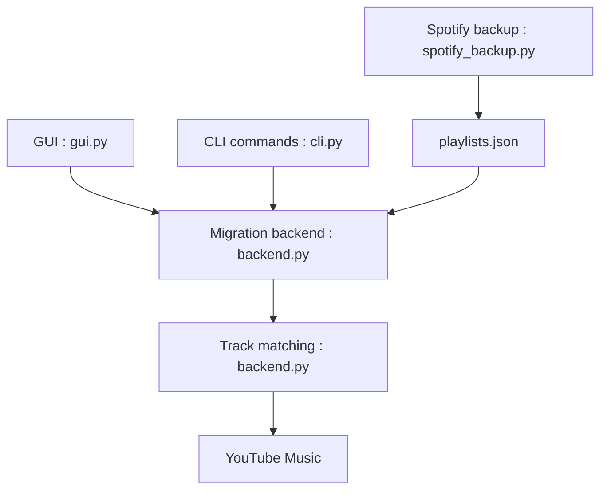

# linsomniac/spotify_to_ytmusic

> Scripts and graphical interface to copy liked tracks and playlists from Spotify to YouTube Music.

## The problem
Switching music platforms without recreating your playlists by hand.

## What it actually does
Backs up Spotify to `playlists.json`, then searches each track on YouTube Music (album by the same artist, then song search) and adds it. Works through the GUI or the command line. Re-running does not duplicate entries, according to the README. YouTube Music credentials are obtained by copying headers from the browser.

## How it is wired


## Trying it
```bash
git clone https://github.com/linsomniac/spotify_to_ytmusic.git
cd spotify_to_ytmusic
python3 -m venv .venv && source .venv/bin/activate
pip install ytmusicapi tk
python3 -m spotify2ytmusic gui
```

## Cost and gotchas
Free. Spotify and YouTube Music accounts required. Long copies can fail (expired session, HTTP 400 errors); the README suggests `--track-sleep=3`. Some commands in the README appear with missing arguments.

## What it is not
Not a managed service nor a mobile application ("No, this runs on Linux/Windows/MacOS"). Matching of obscure tracks can fail.

## Alternatives
No alternative named in the README.

## For you
To watch: unrelated to data/AI, but a handy utility for migrating your playlists; above all it relies on an unofficial API.
