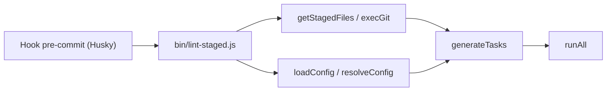

# lint-staged/lint-staged

> Node.js tool that runs formatters and linters only on files staged in git before a commit.

## The problem
Running a formatter or linter on the whole project is slow and reports errors unrelated to the commit; you want to check only what is about to be committed.

## What it actually does
It lists the staged files, filters them by pattern (glob) and runs the configured commands with those files as arguments. It backs up the state in a `git stash`, hides unstaged changes in partially staged files, re-stages the fixes made by the tools and restores the state on failure. Tasks run in parallel by default; configuration in JSON, YAML, JS or TypeScript.

## How it is wired


## Trying it
```bash
npm install --save-dev lint-staged
npx lint-staged --help
npx lint-staged --all
npx lint-staged --diff="main...my-branch"
```

## Cost and gotchas
Free. Requires wiring a git hook (Husky recommended) and installing the tools yourself. It modifies git state: the stash backup helps, but an interrupted process requires a manual restore. Two tasks editing the same file in parallel create a race condition.

## What it is not
It is not a linter or a formatter: it only orchestrates yours. It does not replace CI.

## Alternatives
The README offers `lint-staged.sh`, a simpler shell script that checks without modifying; and mentions Husky for installing hooks.

## For you
Adopt: cheap and proven for keeping a code or notebook repository clean with quick pre-commit checks; requires Node, even in a Python project.
