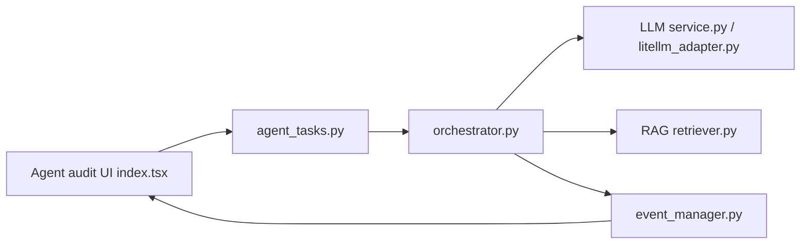

# lintsinghua/DeepAudit

> Code audit platform using LLM agents, for security teams who want fewer false positives.

## The problem
Static analysis tools produce many false positives, ignore business logic spanning several files and do not say whether a flaw is actually exploitable.

## What it actually does
- Imports a project (GitHub/GitLab/Gitea or ZIP) and runs an agent-based audit: Orchestrator, Recon, Analysis, Verification (`orchestrator.py`, `recon.py`, `analysis.py`, `verification.py`).
- The analysis relies on a RAG base (CWE/CVE), the AST and Semgrep; results stream live in the interface.
- The verification agent writes a test script and runs it in an isolated Docker container to confirm the flaw; false positives are discarded.
- Reports exportable as PDF, Markdown, JSON; OpenAI, Claude, Gemini, DeepSeek, Qwen models, or Ollama locally.

## How it is wired


## Trying it
```bash
curl -fsSL https://raw.githubusercontent.com/lintsinghua/DeepAudit/v3.0.0/docker-compose.prod.yml | docker compose -f - up -d
# interface : http://localhost:3000
# ou depuis les sources :
git clone https://github.com/lintsinghua/DeepAudit.git && cd DeepAudit
cp backend/env.example backend/.env
docker compose up -d
```

## Cost and gotchas
LLM API key billed by usage (or local Ollama). Without a local model, the audited code goes to the chosen provider, which the README points out.

## What it is not
Not a tool for testing third-party systems: the README forbids any unauthorized testing and restricts use to research and authorized environments. The version cited for the CVEs is the closed version, not this repository. AGPL-3.0 license.

## Alternatives
Semgrep (built into the base analysis) for static analysis without an LLM; Strix and Kunlun-M, cited in the acknowledgements, for similar approaches.

## For you
Worth watching: interesting as an example of multi-agent orchestration with RAG and sandboxed verification; use it only on code you are allowed to audit, and plan for the LLM cost.
