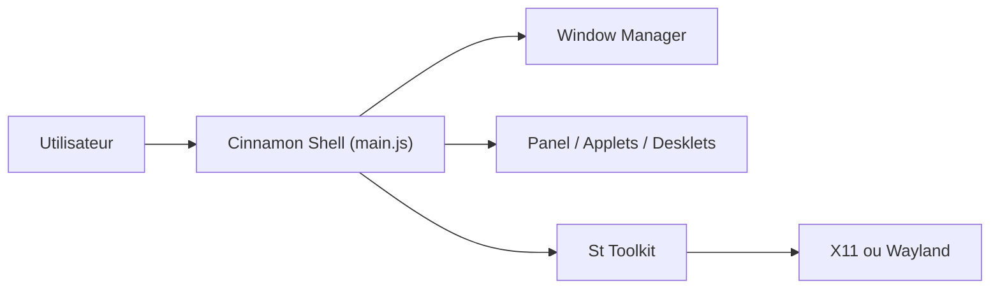

# linuxmint/cinnamon

> Linux desktop environment with a traditional layout, derived from GNOME Shell.

## The problem
README too short (under 800 characters): the problem addressed is not described there. It targets users who want a layout close to GNOME 2.

## What it actually does
Provides a Linux desktop (the README gives no details). From the code: shell, window management, panels, applets, desklets, workspaces, notifications, screensaver, session management.

## How it is wired


## Trying it
```bash
# Aucune commande documentée dans le README.
```

## Cost and gotchas
Not documented. Problems may come from related components: the README points to a list on the project's website.

## What it is not
Not a distribution: it is the desktop environment of Linux Mint (according to the repository owner). License GPL v2 or later.

## Alternatives
GNOME Shell: of which Cinnamon is a fork, according to the README.

## For you
Ignore: a desktop does not serve data/AI work in itself, and the README does not allow saying more.
