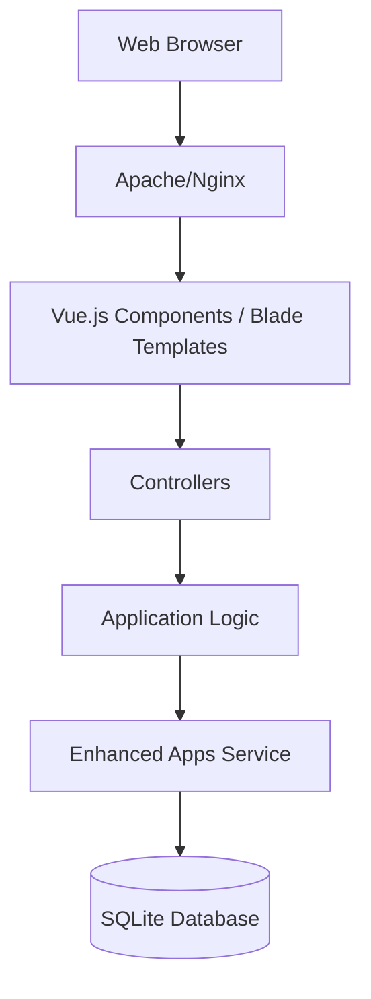

# linuxserver/Heimdall

> Web dashboard to gather the links and applications of your server, with a search bar.

## The problem
Losing track of your links to self-hosted applications in a mass of bookmarks.

## What it actually does
Home page of tiles for your web applications, with search (Google, Bing, DuckDuckGo or custom providers in `searchproviders.yaml`), and "enhanced" applications that display information from the target application. Laravel application with SQLite database, multi-architecture Docker image, translations in more than twenty languages. Protects requests to private IP addresses against SSRF, unless `ALLOW_INTERNAL_REQUESTS=true`.

## How it is wired


## Trying it
```bash
cd /path/to/heimdall
cp .env.example .env
php artisan key:generate
php artisan serve
```

## Cost and gotchas
Free. Outside Docker: PHP 8.4 and extensions, SQLite, zip. Enabling access to internal IPs exposes you to SSRF risks if the instance is public; the app list is downloaded from GitHub (offline: `APP_SOURCE`).

## What it is not
Not a monitoring or container management tool: it is a link directory. No connection with AI or data.

## Alternatives
No alternative named in the README.

## For you
Ignore for your watch profile: handy for a homelab, but no data, AI or MLOps relevance.
