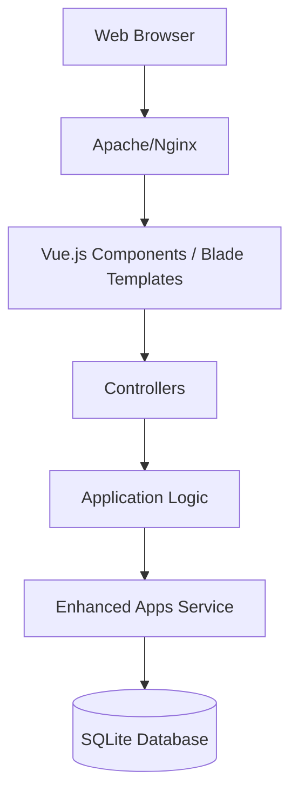

# linuxserver/Heimdall

> Tableau de bord web pour regrouper les liens et applications de ton serveur, avec barre de recherche.

## Le problème
Perdre ses liens vers ses applications auto-hébergées dans une masse de favoris.

## Ce que ça fait vraiment
Page d'accueil de tuiles pour tes applications web, avec recherche (Google, Bing, DuckDuckGo ou fournisseurs personnalisables dans `searchproviders.yaml`), et applications « enhanced » qui affichent des informations de l'application cible. Application Laravel avec base SQLite, image Docker multi-architecture, traductions en plus de vingt langues. Protège les requêtes vers les adresses IP privées contre le SSRF, sauf si `ALLOW_INTERNAL_REQUESTS=true`.

## Comment c'est branché


## Essayer
```bash
cd /path/to/heimdall
cp .env.example .env
php artisan key:generate
php artisan serve
```

## Coût et pièges
Gratuit. Hors Docker : PHP 8.4 et extensions, SQLite, zip. Activer l'accès aux IP internes expose à des risques SSRF si l'instance est publique ; la liste d'apps est téléchargée depuis GitHub (hors ligne : `APP_SOURCE`).

## Ce que ce n'est pas
Pas un outil de supervision ni de gestion de conteneurs : c'est un annuaire de liens. Pas de rapport avec l'IA ou la donnée.

## Alternatives
Aucune alternative nommée dans le README.

## Pour toi
À ignorer pour ton profil de veille : pratique pour un homelab, mais sans enjeu data, IA ou MLOps.

