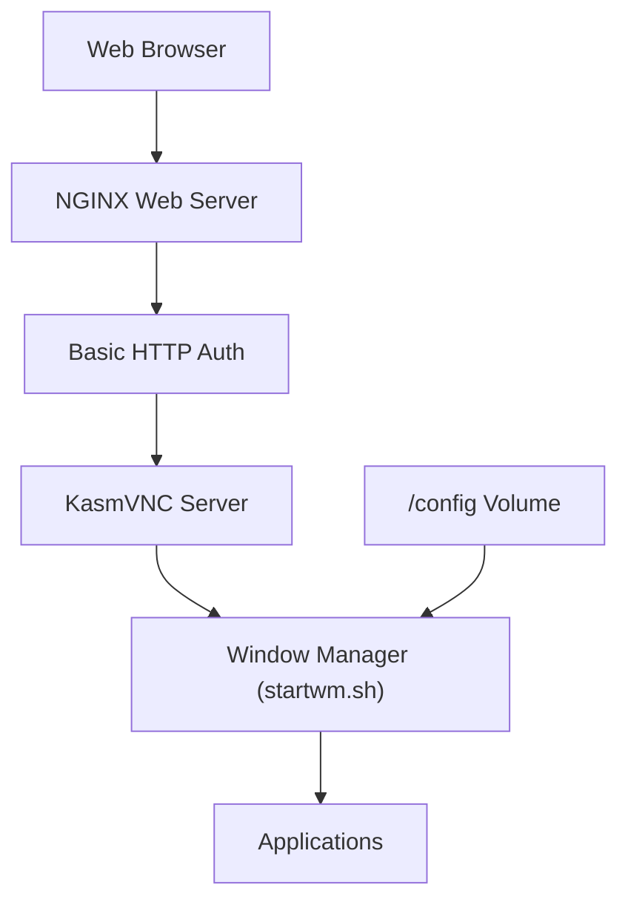

# linuxserver/docker-webtop

> Docker containers with a full Linux desktop (XFCE, KDE, MATE, i3) accessible from a browser.

## The problem
Having a remote Linux desktop, without a heavy client or a dedicated virtual machine.

## What it actually does
Alpine, Ubuntu, Fedora, Arch and Debian images with several desktop environments, streamed to the browser by the Selkies base (HTTPS port 3001). Detects an Intel, AMD or Nvidia GPU, handles file transfer, clipboard, audio and gamepads. Persistent applications via proot-apps or Docker modifications.

## How it is wired
Diagram based on the provided diagram (which still mentions KasmVNC, replaced by Selkies in the README).



## Trying it
```bash
docker run --rm -it \
  --shm-size=1gb \
  -p 3001:3001 \
  lscr.io/linuxserver/webtop:latest bash
```

## Cost and gotchas
Free. No authentication by default, with a terminal that has passwordless `sudo`: never expose it to the Internet without an authenticated proxy. Plan for `--shm-size=1gb`; Nvidia GPU support needs a recent driver.

## What it is not
Not a secure remote desktop as is. Not a virtual machine: the container shares the kernel and can give privileged access to the host.

## Alternatives
SealSkin for multi-user orchestration, and Pelorus to expose the session to AI agents, both cited in the README.

## For you
Worth watching: handy for a disposable workstation or a computer-use agent sandbox, provided you lock it behind authentication.
