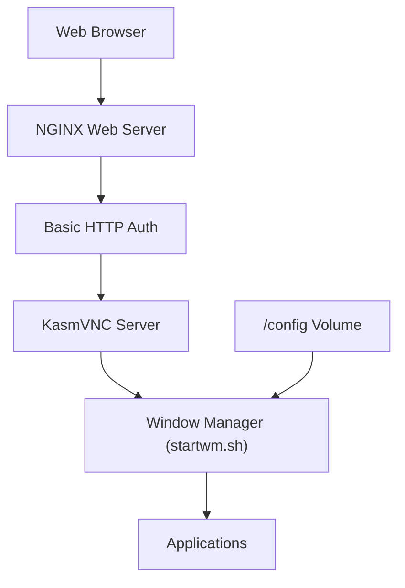

# linuxserver/docker-webtop

> Conteneurs Docker avec un bureau Linux complet (XFCE, KDE, MATE, i3) accessible depuis un navigateur.

## Le problème
Disposer d'un bureau Linux à distance, sans client lourd ni machine virtuelle dédiée.

## Ce que ça fait vraiment
Images Alpine, Ubuntu, Fedora, Arch et Debian avec plusieurs environnements de bureau, diffusées dans le navigateur par la base Selkies (HTTPS port 3001). Détecte un GPU Intel, AMD ou Nvidia, gère transfert de fichiers, presse-papiers, audio et manettes. Applications persistantes via proot-apps ou modifications Docker.

## Comment c'est branché
Schéma d'après le diagramme fourni (qui cite encore KasmVNC, remplacé par Selkies dans le README).



## Essayer
```bash
docker run --rm -it \
  --shm-size=1gb \
  -p 3001:3001 \
  lscr.io/linuxserver/webtop:latest bash
```

## Coût et pièges
Gratuit. Par défaut sans authentification, avec un terminal à `sudo` sans mot de passe : ne jamais l'exposer sur Internet sans proxy authentifié. Prévoir `--shm-size=1gb` ; le GPU Nvidia demande un pilote récent.

## Ce que ce n'est pas
Pas un bureau distant sécurisé en l'état. Pas une machine virtuelle : le conteneur partage le noyau et peut donner un accès privilégié à l'hôte.

## Alternatives
SealSkin pour l'orchestration multi-utilisateurs, et Pelorus pour exposer la session à des agents IA, tous deux cités dans le README.

## Pour toi
À surveiller : pratique pour un poste de travail jetable ou un bac à sable d'agent computer-use, à condition de l'enfermer derrière une authentification.

