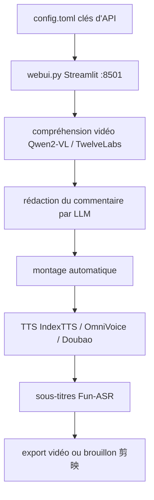

# linyqh/NarratoAI

> Automated video commentary tool: writing, editing, dubbing and subtitles in a single flow.

## The problem
Producing a film commentary video chains writing, cutting, voice-over and subtitles, each with its own tool.
Video understanding and TTS models change fast, so a homemade editing setup goes stale.

## What it actually does
Single LLM-driven pipeline: writing the text, automatic editing, dubbing, subtitle generation, also exported as a 剪映 draft.
Video understanding by Qwen2-VL or, optionally, TwelveLabs Pegasus (`vision_llm_provider = "twelvelabs"`) to pick the highlights.
Multiple TTS engines including IndexTTS-1.5 voice cloning (MLX for Apple Silicon), IndexTTS-2 MLX, OmniVoice, Doubao TTS and Tencent Cloud; one-click transcription via Fun-ASR.
Streamlit UI at `http://127.0.0.1:8501`, as an all-in-one Windows/macOS package, Docker or local launch via `uv`.

## How it is wired


## Trying it
```bash
git clone https://github.com/linyqh/NarratoAI.git
cd NarratoAI
docker compose up -d
uv sync
cp config.example.toml config.toml
uv run streamlit run webui.py --server.maxUploadSize=2048
xattr -cr "/path/to/NarratoAI-macos-arm64"
```

## Cost and gotchas
The README pushes several sponsored API providers with referral codes: keys and usage are at your expense.
Announced hardware: 4 cores and 8 GB of RAM minimum, Python 3.12+, GPU not required. The author also warns about resellers who rename and sell this free software.

## What it is not
Not a manual video editor: it is an automatic pipeline, fine adjustment goes through the export to 剪映.
Not independent of third-party services: video understanding, LLM and cloud TTS require accounts.
Not documented in English in this block: the supplied content is in Chinese, apart from a few links.

## Alternatives
- FujiwaraChoki/MoneyPrinter and harry0703/MoneyPrinterTurbo: projects this one is a rework of, cited by the author.

## For you
Outside your scope: content production tool, with sponsors and referrals front and center.
