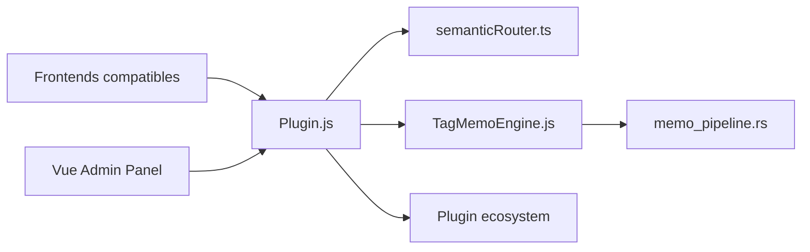

# lioensky/VCPToolBox

> AI agent platform with persistent memory, plugins and model routing, for agent tinkerers with no limit on complexity.

## The problem
Classic agents start from scratch on every request: no continuous memory, no awareness of their environment, fragile tools.

## What it actually does
A Node server that assembles the context before each call: associative memory ("TagMemo" engine, RiverMemo Rust core), a unified multi-frontend thread, context folding, semantic model routing. Tools are called through text tags (no native function calling), more than 300 plugins are claimed, distributed nodes, an agent forum, a Vue admin panel. The code is reportedly written mostly by 8 AI agents.

## How it is wired


## Trying it
```bash
git clone https://github.com/lioensky/VCPToolBox.git
cd VCPToolBox
npm install
pip install -r requirements.txt
cp config.env.example config.env
node server.js
```

## Cost and gotchas
API keys at your expense. The README forbids relay or mirror APIs: the agents have deep permissions. CC BY-NC-SA 4.0 license: non-commercial use only.

## What it is not
Not a simple tool framework; the text is mostly philosophical, with few verifiable measurements.

## Alternatives
No alternative named in the README (VCPChat is the recommended frontend).

## For you
Worth watching: interesting memory ideas, but non-commercial license, a single maintainer and a README that is more manifesto than proof; unsuitable for professional use.
