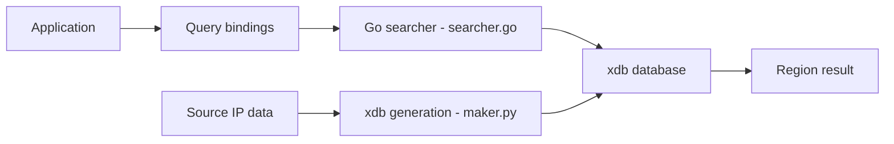

# lionsoul2014/ip2region

> Offline IP geolocation library (IPv4/IPv6) in the xdb format, with clients in many languages.

## The problem
Geolocating an IP address without calling an external service, with microsecond-order latency.

## What it actually does
Provides IPv4/IPv6 source data and `xdb` files (fields: country|province|city|operator|ISO code). The format merges and deduplicates ranges. 10 µs response when loading the whole xdb in memory, about 100 µs with the vector index (512 KiB). Query clients (Go, Java, Python, Rust, C, JS, PHP, C#, Nginx…) and xdb generators.

## How it is wired

## Trying it
No single command in the README: each client (`searcher`) and generator (`maker`) has its own README.

## Cost and gotchas
Free. The data is updated irregularly; the README recommends commercial data for high accuracy. Chinese regions are in Chinese, the others in English.

## What it is not
Not an accurate, up-to-date geolocation service. Not a remote API. License not identified by GitHub.

## Alternatives
No alternative named in the README (commercial data is mentioned there without a name).

## For you
Worth watching: useful for enriching logs or datasets offline, provided you accept approximate data and check the license.
