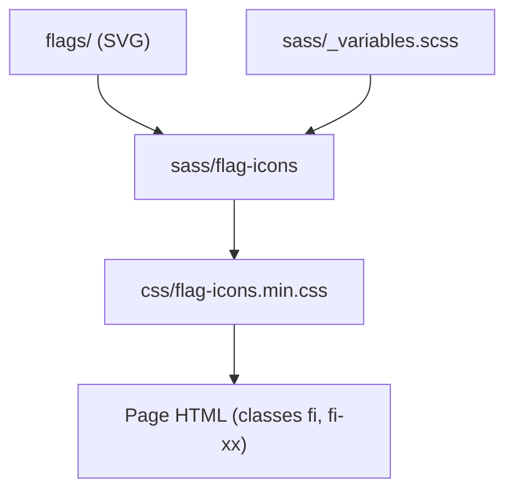

# lipis/flag-icons

> Collection of flags of all countries in SVG, with ready-to-use CSS, for web developers.

## The problem
Displaying country flags in an interface requires finding, cleaning and sizing images.

## What it actually does
Provides one SVG per country (ISO 3166-1 alpha-2 codes), in 4:3 or square format, with `fi` and `fi-xx` CSS classes. Available as CSS, SASS or via CDN. The SASS lets you include only some countries (`$flag-icons-included-countries`).

## How it is wired
Simplified diagram based on the sheet, no diagram provided.



## Trying it
```bash
npm install flag-icons
# ou
yarn add flag-icons
yarn build
yarn start
```

## Cost and gotchas
Free. Requires Node to compile the SASS. Flags are politically sensitive: the README says nothing about disputed territories.

## What it is not
It is not a ready-to-use React or Vue component: it is CSS classes. It is not a database of countries.

## Alternatives
No alternative named in the README.

## For you
Useful only for a dashboard or a web demo showing countries (languages, regions); with no data/AI/MLOps stake, ignore.
