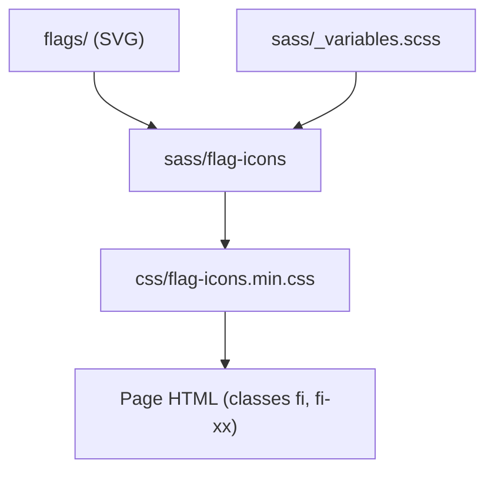

# lipis/flag-icons

> Collection de drapeaux de tous les pays en SVG, avec CSS prêt à l'emploi, pour développeurs web.

## Le problème
Afficher des drapeaux de pays dans une interface demande de trouver, nettoyer et dimensionner des images.

## Ce que ça fait vraiment
Fournit un SVG par pays (codes ISO 3166-1 alpha-2), en format 4:3 ou carré, avec des classes CSS `fi` et `fi-xx`. Disponible en CSS, SASS ou via CDN. Le SASS permet de n'inclure que certains pays (`$flag-icons-included-countries`).

## Comment c'est branché
Schéma simplifié d'après la fiche, sans diagramme fourni.



## Essayer
```bash
npm install flag-icons
# ou
yarn add flag-icons
yarn build
yarn start
```

## Coût et pièges
Gratuit. Nécessite Node pour compiler le SASS. Les drapeaux sont sensibles politiquement : le README ne dit rien sur les territoires contestés.

## Ce que ce n'est pas
Ce n'est pas un composant React ou Vue prêt à l'emploi : ce sont des classes CSS. Ce n'est pas une base de données de pays.

## Alternatives
Aucune alternative nommée dans le README.

## Pour toi
Utile uniquement pour un tableau de bord ou une démo web montrant des pays (langues, régions) ; sans enjeu data/IA/MLOps, à ignorer.

