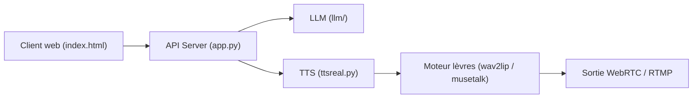

# lipku/LiveTalking

> Real-time digital human engine: animates an avatar whose lips follow the voice, in an audio-video stream.

## The problem
Creating a responsive virtual presenter (livestream, customer service) requires assembling speech synthesis, a lip-sync model and low-latency video streaming.

## What it actually does
Receives text or audio, optionally calls an LLM, synthesizes the voice (EdgeTTS, GPT-SoVITS, CosyVoice, Tencent), generates lip movements with Wav2Lip, MuseTalk, ERNeRF or Ultralight, then streams over WebRTC, RTMP or virtual camera. Handles speech interruption, multiple sessions and voice cloning. A paid commercial version exists alongside the open source one.

## How it is wired


## Trying it
```bash
git clone https://github.com/lipku/LiveTalking.git
conda create -n livetalking python=3.12
conda activate livetalking
pip install -r requirements.txt
python app.py --transport webrtc --model wav2lip --avatar_id wav2lip256_avatar1
```

## Cost and gotchas
Free on the code side, but you need a GPU (RTX 3060 minimum for wav2lip256), download the models by hand and open TCP port 8010 and UDP. Published videos must carry the LiveTalking watermark.

## What it is not
Not a turnkey solution: advanced features are reserved for the commercial version.

## Alternatives
No alternative named in the README.

## For you
Worth watching: a good testbed for a conversational avatar on a local GPU, but the watermark obligation and the paid version limit its use.
