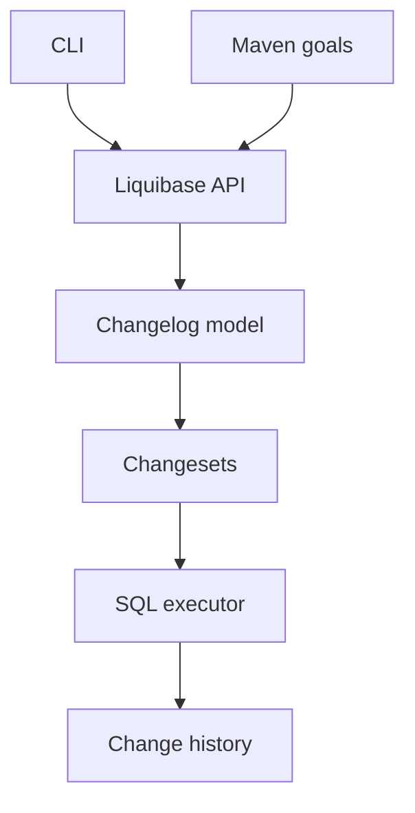

# liquibase/liquibase

> Tool for tracking, versioning and deploying database schema changes.

## The problem
Schema changes made by hand cause errors and delays in going to production, with a hard rollback.

## What it actually does
Reads changelogs, selects the changesets not yet applied, runs them on the database via JDBC and records the history to allow status and rollback. Also generates a diff between schemas. Used from the CLI, with Maven, Gradle, Spring Boot or CI/CD; official Docker images.

## How it is wired


## Trying it
```bash
liquibase init start-h2
liquibase update
liquibase history
docker pull liquibase/liquibase
```

## Cost and gotchas
Community edition is free; the `liquibase-secure` image is commercial. Databases outside the core need extensions. Community releases are quarterly. Repository license not identified by GitHub.

## What it is not
Not a data migration tool: it versions the schema. Advanced features are in the paid offering.

## Alternatives
No alternative named in the README.

## For you
Worth watching: useful for versioning the schemas of your feature or MLOps metadata databases, after checking the license.
