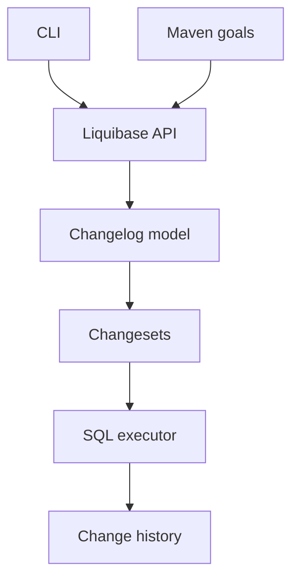

# liquibase/liquibase

> Outil de suivi, versionnement et déploiement des changements de schéma de base de données.

## Le problème
Les changements de schéma faits à la main provoquent des erreurs et des retards de mise en production, avec un retour arrière difficile.

## Ce que ça fait vraiment
Lit des changelogs, sélectionne les changesets non encore appliqués, les exécute sur la base via JDBC et consigne l'historique pour permettre statut et rollback. Génère aussi un diff entre schémas. S'utilise en CLI, avec Maven, Gradle, Spring Boot ou CI/CD ; images Docker officielles.

## Comment c'est branché


## Essayer
```bash
liquibase init start-h2
liquibase update
liquibase history
docker pull liquibase/liquibase
```

## Coût et pièges
Édition Community gratuite ; l'image `liquibase-secure` est commerciale. Les bases hors noyau demandent des extensions. Versions communautaires trimestrielles. Licence du dépôt non identifiée par GitHub.

## Ce que ce n'est pas
Pas un outil de migration de données : il versionne le schéma. Les fonctions avancées sont dans l'offre payante.

## Alternatives
Aucune alternative nommée dans le README.

## Pour toi
À surveiller : utile pour versionner les schémas de tes bases de features ou métadonnées MLOps, après vérification de la licence.

