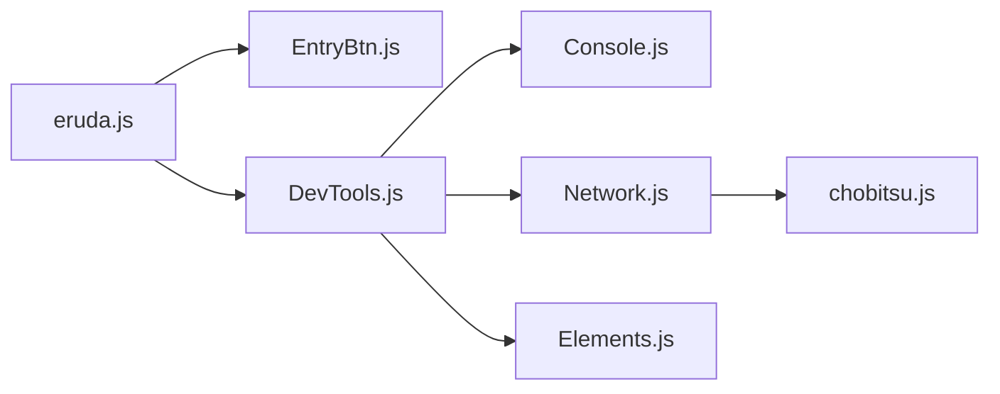

# liriliri/eruda

> Debugging console embedded in the page for mobile browsers, for web developers.

## The problem
On a phone there are no developer tools: impossible to inspect the console, network or DOM.

## What it actually does
You load the script and call `eruda.init()`: a button opens a tools interface (console, network, elements, resources, storage, cookies, sources, snippets, info, settings). Network goes through a protocol adapter (chobitsu, a JS implementation of the DevTools protocol). Online documentation details usage.

## How it is wired


## Trying it
```bash
npm install eruda --save-dev
```
```html
<script src="node_modules/eruda/eruda.js"></script>
<script>eruda.init();</script>
```

## Cost and gotchas
Free. Last push in August 2025. Do not leave the console active in public production.

## What it is not
Not a remote debugger: for that, the README points to the separate project chii.

## Alternatives
chii: remote debugging tool by the same author.

## For you
Useful if you build a web app viewed on mobile; little connection to a data/AI pipeline.
