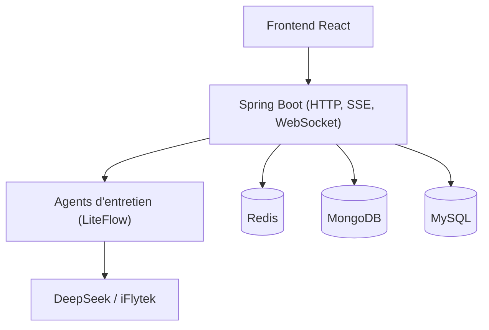

# lishuangqiang/AI-Meeting

> Spring Boot backend for AI-simulated interviews: CV analysis, questions, scoring and voice.

## The problem
Preparing for a technical interview without personalized feedback on your CV or follow-up questions.

## What it actually does
After a PDF CV is uploaded, agents generate questions, score the answers and ask follow-ups. Long interview state is kept in MongoDB and Redis, with a check so that the same AI request is executed only once. The repo adds SSE chat, real-time speech recognition and speech synthesis via iFlytek. Several models are plugged in through an OpenAI-compatible protocol.

## How it is wired
Simplified diagram based on the sheet, no diagram provided.



## Trying it
```bash
./mvnw -B -ntp clean verify
```

## Cost and gotchas
Requires MySQL, MongoDB, Redis and keys from Chinese model and voice providers. The README says the real secrets have not yet been cleaned out. Access to the paid SaaS version goes through WeChat.

## What it is not
Not the commercial version: the Chiron Agent SaaS is paid and its source is not under MIT. The README is in Chinese, with paid consulting offers.

## Alternatives
No alternative named in the README.

## For you
Ignore: a Java architecture demo for the Chinese market, tied to local providers, with little value for a data or MLOps profile.
