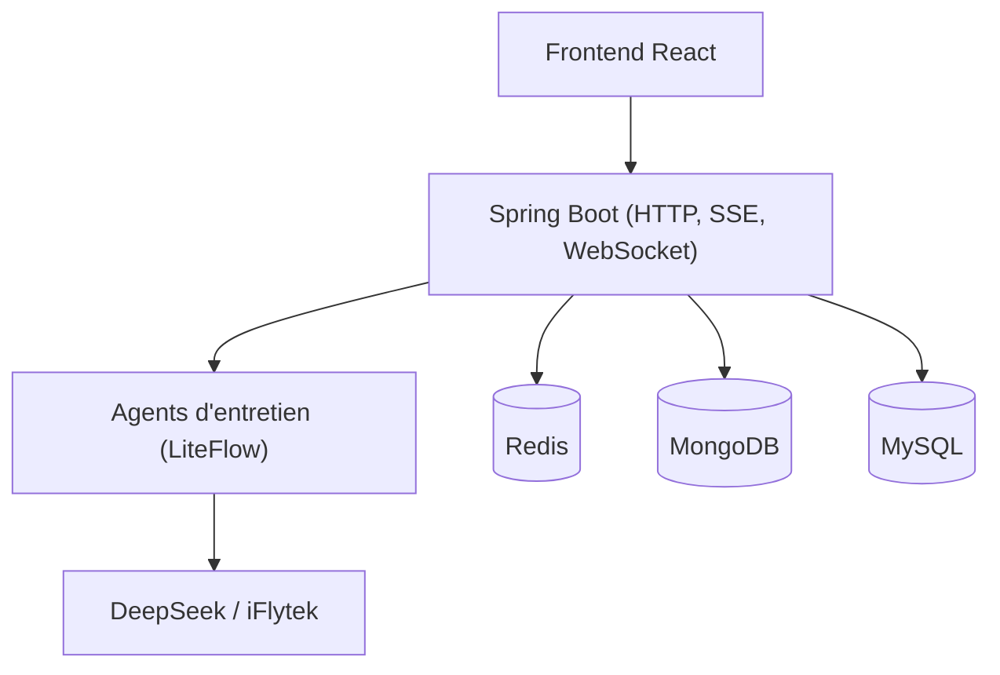

# lishuangqiang/AI-Meeting

> Backend Spring Boot d'entretiens simulés par IA : analyse de CV, questions, scoring et voix.

## Le problème
Se préparer à un entretien technique sans retour personnalisé sur son CV ni questions de relance.

## Ce que ça fait vraiment
Après dépôt d'un CV PDF, des agents génèrent des questions, notent les réponses et relancent. L'état d'entretien long est conservé dans MongoDB et Redis, avec un contrôle pour qu'une même requête d'IA ne soit exécutée qu'une fois. Le dépôt ajoute chat en SSE, reconnaissance vocale en temps réel et synthèse vocale via iFlytek. Plusieurs modèles sont branchés via un protocole compatible OpenAI.

## Comment c'est branché
Schéma simplifié d'après la fiche, sans diagramme fourni.



## Essayer
```bash
./mvnw -B -ntp clean verify
```

## Coût et pièges
Il faut MySQL, MongoDB, Redis et des clés de fournisseurs de modèles et de voix chinois. Le README dit que les secrets réels n'ont pas encore été nettoyés. L'accès à la version SaaS payante passe par WeChat.

## Ce que ce n'est pas
Pas la version commerciale : le SaaS Chiron Agent est payant et sa source n'est pas sous MIT. Le README est en chinois, avec des offres de consultation payante.

## Alternatives
Aucune alternative nommée dans le README.

## Pour toi
À ignorer : démonstration d'architecture Java pour le marché chinois, liée à des fournisseurs locaux, avec peu d'apport pour un profil data ou MLOps.

