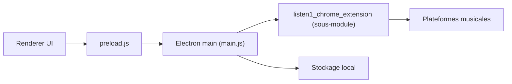

# listen1/listen1_desktop

> Desktop music player that aggregates several Chinese music platforms.

## The problem
Listening to tracks spread across several music sites means juggling between applications.

## What it actually does
Electron application that searches and plays tracks from several platforms (NetEase, QQ Music, Kugou, Kuwo, bilibili, Migu, Qianqian), with favorites and playlists. The search and playback logic comes from a submodule shared with the Chrome extension; no server of its own.

## How it is wired


## Trying it
```bash
git submodule update --init --recursive
npm run start
npm run dist
```

## Cost and gotchas
Free. Depends on third-party site APIs, which may change. README in Chinese; 958 open issues.

## What it is not
Not a music service: it plays content from third-party platforms. Last push on 2026-04-07.

## Alternatives
No alternative named in the README.

## For you
Ignore: consumer music player, outside the data/AI/MLOps scope.
