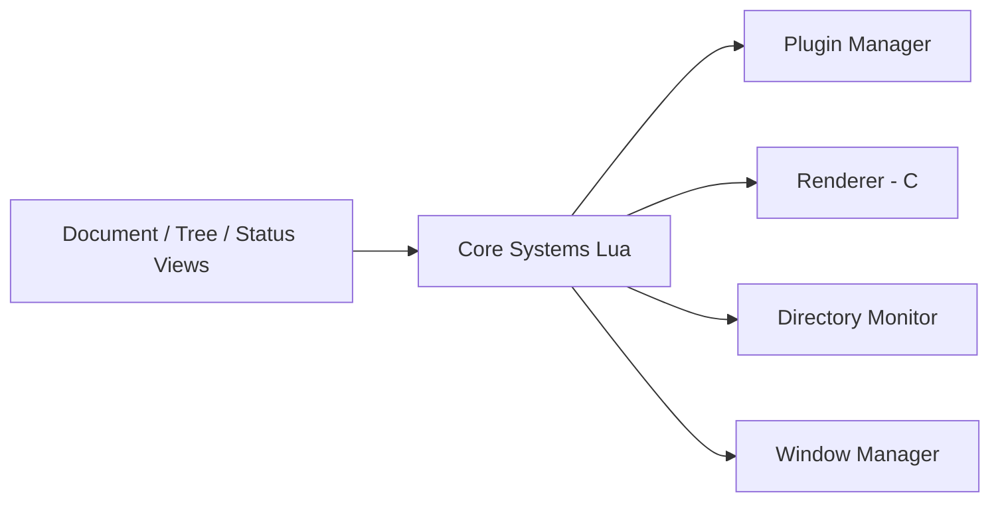

# lite-xl/lite-xl

> Lightweight text editor written in Lua, derived from lite, extensible through plugins.

## The problem
Common editors are heavy; you want an editor that is fast, small and modifiable.

## What it actually does
Editor with a C core (rendering, directory watching, system) and Lua logic (documents, commands, views), with plugins and themes. It improves on lite: font rendering, high screen density, retina on macOS, lower CPU usage. Compatible with most lite plugins and themes.

## How it is wired


## Trying it
```bash
bash scripts/build.sh --help
meson setup --buildtype=release --prefix <prefix> build
meson compile -C build
DESTDIR="$(pwd)/lite-xl" meson install --skip-subprojects -C build
```

## Cost and gotchas
Free. Build requires: Meson, Ninja, SDL2, PCRE2, FreeType2, Lua 5.4. macOS binaries are signed with a self-signed certificate (manual opening). Last push 2026-03-11.

## What it is not
Not a full IDE: additional features come through plugins.

## Alternatives
lite (rxi/lite) is the base it derives from.

## For you
To watch: minimal editor that is pleasant to script; does not replace an IDE for data/AI development.
