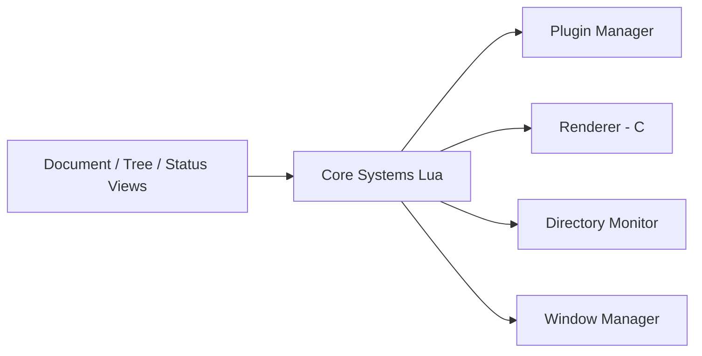

# lite-xl/lite-xl

> Éditeur de texte léger écrit en Lua, dérivé de lite, extensible par plugins.

## Le problème
Les éditeurs courants sont lourds ; on veut un éditeur rapide, petit et modifiable.

## Ce que ça fait vraiment
Éditeur à cœur C (rendu, surveillance de répertoires, système) et logique en Lua (documents, commandes, vues), avec plugins et thèmes. Il améliore lite : rendu des polices, haute densité d'écran, retina sur macOS, moindre usage du CPU. Compatible avec la plupart des plugins et thèmes de lite.

## Comment c'est branché


## Essayer
```bash
bash scripts/build.sh --help
meson setup --buildtype=release --prefix <prefix> build
meson compile -C build
DESTDIR="$(pwd)/lite-xl" meson install --skip-subprojects -C build
```

## Coût et pièges
Gratuit. Compilation : Meson, Ninja, SDL2, PCRE2, FreeType2, Lua 5.4. Binaires macOS signés par certificat auto-signé (ouverture manuelle). Dernier push 2026-03-11.

## Ce que ce n'est pas
Pas un IDE complet : fonctions additionnelles via plugins.

## Alternatives
lite (rxi/lite) est la base dont il dérive.

## Pour toi
À surveiller : éditeur minimal agréable à scripter ; ne remplace pas un IDE pour le développement data/IA.

