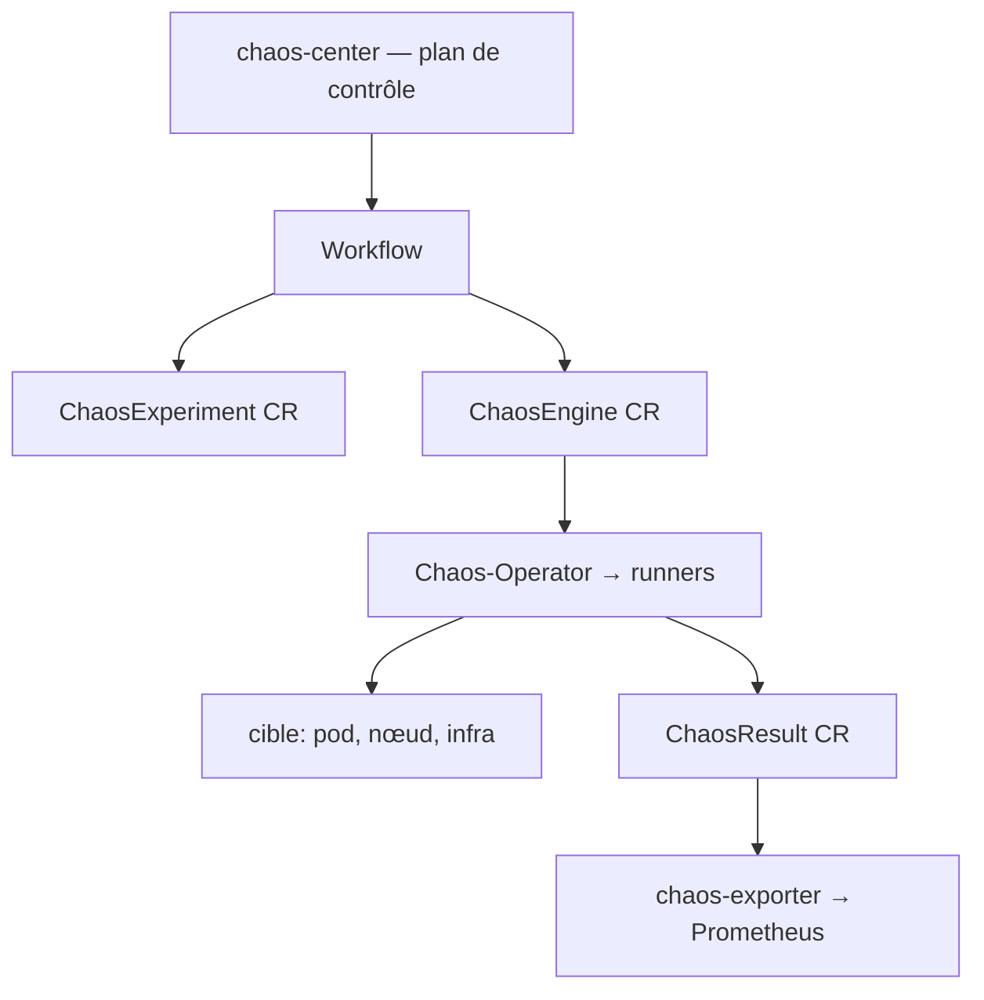

# litmuschaos/litmus

> CNCF chaos engineering platform for Kubernetes, driven by custom resources.

## The problem
You discover a deployment's weaknesses on the day of the outage, not before.
Injecting failures by hand is neither reproducible nor measurable.

## What it actually does
Three CRDs structure everything: `ChaosExperiment` (parameters and permissions of a fault, installable as a template), `ChaosEngine` (binds a workload, a node or an infra to that fault, with steady-state validation probes), `ChaosResult` (result, rollback and verdict).
The `chaos-center` control plane builds, schedules and visualizes chaos workflows; the execution plane is an agent plus operators in the targeted environment.
The `ChaosExperiment` supports BYOC — plugging in a third-party tool for fault injection — rather than imposing its own library.
The `chaos-exporter` reads the results and exposes them as Prometheus metrics, which makes automated runs usable.

## How it is wired


## Trying it
No command is given in the README: it points to the Installation section of the "Getting Started with Litmus" page in the documentation.

```bash
# aucune commande documentée dans le README — voir les Litmus Docs
```

## Cost and gotchas
Free and CNCF, but you need a Kubernetes cluster and must accept that the platform itself runs as a set of microservices.
Experiments come from a public hub (`hub.litmuschaos.io`) fed by third-party developers and vendors: audit before running in production.

## What it is not
Not a one-off fault injection tool: it is a platform with a control plane, agents and operators.
Nor is it limited to developers — the three advertised uses are dev, CI/CD pipeline and SRE.
The README is mostly a list of talks and blog posts: the technical substance lies in the description of the CRDs.

## Alternatives
No alternative is named in the README.

## For you
Useful the day your inference services have an SLO; until then, it is SRE tooling, not data.
