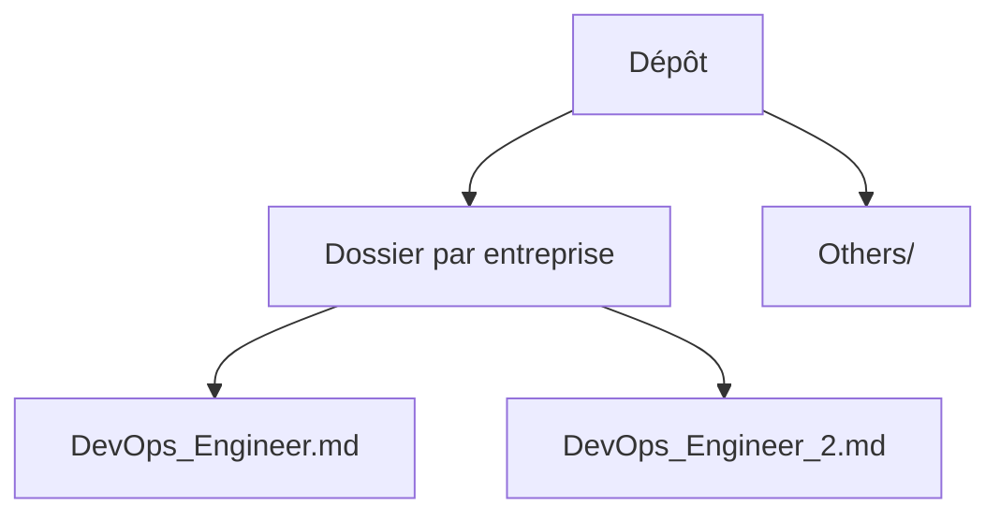

# litu54/DevOps-Interview-Guide

> Collection of real DevOps, SRE and cloud interview questions, sorted by company, to prepare for an interview.

## The problem
"Top 50 questions" lists are generic; you don't know what a specific company actually asked.

## What it actually does
151 interview reports from 2025 and 2026 for 85 companies, plus an `Others/` folder. One sheet per interview, in one folder per company (`DevOps_Engineer.md`, `SRE_principal.md`...). Topics: Kubernetes, Docker, Terraform, AWS/Azure/GCP, CI/CD, Ansible, Linux, scripting, SRE basics.

## How it is wired
Simplified diagram based on the sheet, no diagram provided.

## Trying it
No documented command: search for a company name in the repository or open its folder.

## Cost and gotchas
Free. No license declared. The questions come from testimonials, with no review and no answers announced in the README.

## What it is not
It is not a course or an answer key: there are only questions. It is not exhaustive.

## Alternatives
No alternative named in the README.

## For you
Worth watching: useful for preparing an MLOps interview on the infrastructure side, with no technical value outside preparation.
