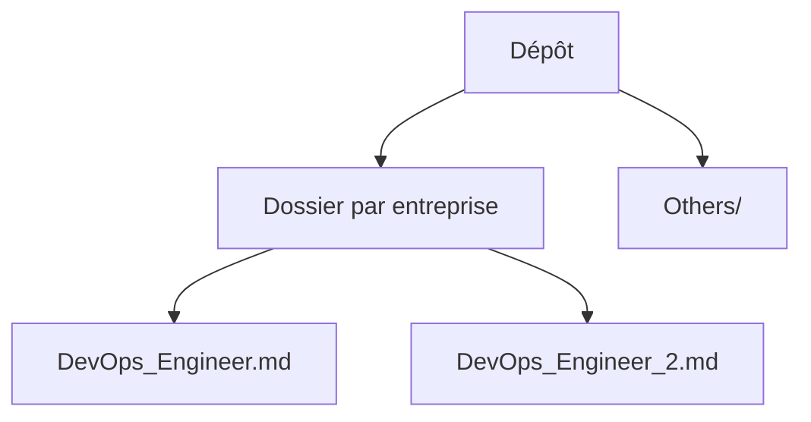

# litu54/DevOps-Interview-Guide

> Recueil de vraies questions d'entretien DevOps, SRE et cloud, classées par entreprise, pour préparer un entretien.

## Le problème
Les listes « top 50 questions » sont génériques ; on ne sait pas ce qu'une entreprise précise a vraiment demandé.

## Ce que ça fait vraiment
151 comptes rendus d'entretiens de 2025 et 2026 pour 85 entreprises, plus un dossier `Others/`. Une fiche par entretien, dans un dossier par société (`DevOps_Engineer.md`, `SRE_principal.md`...). Thèmes : Kubernetes, Docker, Terraform, AWS/Azure/GCP, CI/CD, Ansible, Linux, scripts, bases du SRE.

## Comment c'est branché
Schéma simplifié d'après la fiche, sans diagramme fourni.

## Essayer
Aucune commande documentée : chercher un nom d'entreprise dans le dépôt ou ouvrir son dossier.

## Coût et pièges
Gratuit. Aucune licence déclarée. Les questions viennent de témoignages, sans relecture ni réponses annoncées dans le README.

## Ce que ce n'est pas
Ce n'est pas un cours ni un corrigé : il n'y a que des questions. Ce n'est pas exhaustif.

## Alternatives
Aucune alternative nommée dans le README.

## Pour toi
À surveiller : utile pour préparer un entretien MLOps côté infrastructure, sans valeur technique en dehors de la préparation.

