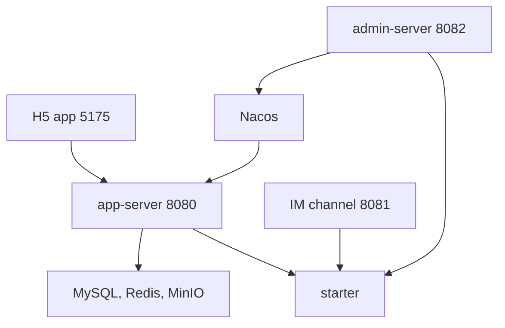

# liulangjietou/customer_work

> Java AI-agent customer service platform (AgentScope), with an admin console and governance.

## The problem
Building an agent-based customer service requires linking conversation, business tools, human validation, tickets and governance.

## What it actually does
Java system (JDK 17, Spring Boot): a ReAct agent answers over HTTP, SSE or WebSocket, and calls business tools via SPIs, MCP and a RAG. Refunds are submitted for human approval, tickets have seven states, CSAT. The console manages models, evaluations, publication via Nacos, billing and quotas. Models: Bailian by default, OpenAI, Anthropic, Gemini, Ollama. README in Chinese.

## How it is wired
Diagram based on the README.



## Trying it
```bash
docker compose up -d mysql
export DASHSCOPE_API_KEY=...
mvn -pl customer-work-app-server -am -DskipTests package
java -jar customer-work-app-server/target/customer-work.jar
curl -fsS http://localhost:8080/actuator/health
```

## Cost and gotchas
DashScope key (or another provider's) at your expense, MySQL, JDK 17 and Maven (not listed). The root Compose file includes neither admin, nor channel, nor gateway. No circuit breaker on model costs.

## What it is not
Not a production-validated product: the README states that starting up is not business integration, identity or production. Real payment is not wired up.

## Alternatives
None cited in the README.

## For you
Keep an eye on it: an agent architecture reference (human approval, evaluations, FinOps) worth reading, but single-author, experimental and in Chinese.
