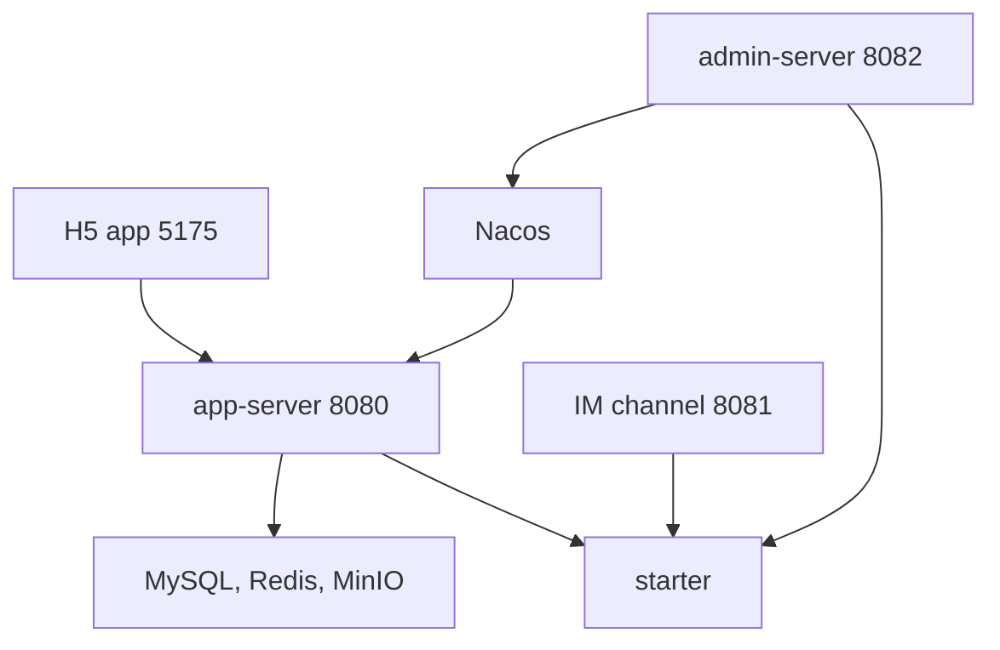

# liulangjietou/customer_work

> Plateforme de service client à agents IA en Java (AgentScope), avec console d'administration et gouvernance.

## Le problème
Construire un service client à agents demande de relier conversation, outils métier, validation humaine, tickets et gouvernance.

## Ce que ça fait vraiment
Système Java (JDK 17, Spring Boot) : un agent ReAct répond par HTTP, SSE ou WebSocket, appelle des outils métier via des SPI, des MCP et un RAG. Remboursements soumis à approbation humaine, tickets à sept états, CSAT. La console gère modèles, évaluations, publication via Nacos, facturation et quotas. Modèles : Bailian par défaut, OpenAI, Anthropic, Gemini, Ollama. README en chinois.

## Comment c'est branché
Schéma d'après le README.



## Essayer
```bash
docker compose up -d mysql
export DASHSCOPE_API_KEY=...
mvn -pl customer-work-app-server -am -DskipTests package
java -jar customer-work-app-server/target/customer-work.jar
curl -fsS http://localhost:8080/actuator/health
```

## Coût et pièges
Clé DashScope (ou autre fournisseur) à ta charge, MySQL, JDK 17 et Maven (hors liste). Le Compose racine n'inclut ni admin, ni canal, ni passerelle. Pas de coupe-circuit sur les coûts de modèle.

## Ce que ce n'est pas
Pas un produit validé en production : le README précise que démarrer ne vaut pas intégration métier, identité ni production. Le paiement réel n'est pas câblé.

## Alternatives
Aucune citée dans le README.

## Pour toi
Surveiller : référence d'architecture d'agents (approbation humaine, évaluations, FinOps) à lire, mais mono-auteur, expérimental et en chinois.

