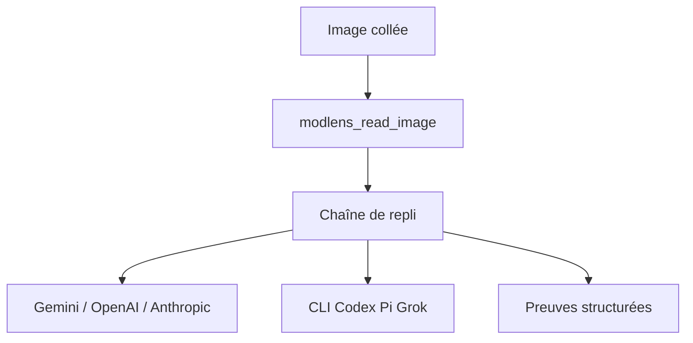

# liustack/modlens

> Vision engine as a plugin that gives image reading to a text-only model.

## The problem
Text-only DeepSeek or GLM models cannot read images pasted into the conversation.

## What it actually does
The plugin sends the image to a vision engine (Gemini, an OpenAI-compatible endpoint, Anthropic, Antigravity, Claude Code, Kimi, or reused Codex, OpenCode, Pi, Grok CLIs) and returns the transcription, layout regions, entities and relations. The engines form a fallback chain, and keys rotate when a quota is hit. Works in DeepSeek Harness, Claude Code, Codex, Pi, OpenCode.

## How it is wired
Simplified diagram based on the sheet, no diagram provided.


## Trying it
```bash
npx -y skills add liustack/modlens --skill modlens --global
npx -y @deepseek-ai/dsh plugin --profile web add @liustack/modlens@3.27.2
modlens config set openai.apiKey <key>
```

## Cost and gotchas
A free Gemini key is enough, but each read consumes the quota of a third-party engine, sometimes your CLI subscription (consent is requested). Reading takes 5 to 45 seconds depending on the engine.

## What it is not
Not a vision model: it delegates to another one. Images go to external services, so do not use it for sensitive data without checking.

## Alternatives
ModSearch, a sibling project by the same author, gives web search to models that lack it.

## For you
Worth watching: handy for giving a text model vision at low cost, with a dependency on third-party services and a single maintainer.
