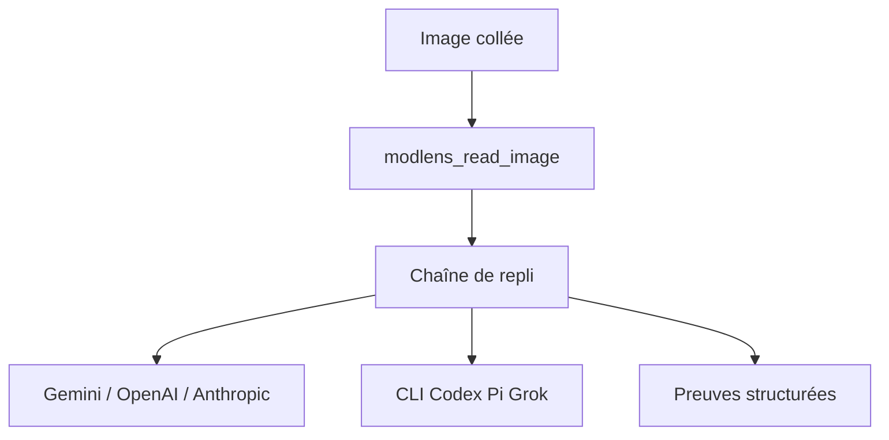

# liustack/modlens

> Moteur de vision en plugin qui donne la lecture d'images à un modèle de texte seul.

## Le problème
Les modèles DeepSeek ou GLM de texte seul ne lisent pas les images collées dans la conversation.

## Ce que ça fait vraiment
Le plugin envoie l'image à un moteur de vision (Gemini, endpoint compatible OpenAI, Anthropic, Antigravity, Claude Code, Kimi, ou CLI Codex, OpenCode, Pi, Grok réutilisés) et renvoie transcription, régions de mise en page, entités et relations. Les moteurs forment une chaîne de repli, et les clés se renouvellent en cas de quota. Fonctionne dans DeepSeek Harness, Claude Code, Codex, Pi, OpenCode.

## Comment c'est branché
Schéma simplifié d'après la fiche, sans diagramme fourni.


## Essayer
```bash
npx -y skills add liustack/modlens --skill modlens --global
npx -y @deepseek-ai/dsh plugin --profile web add @liustack/modlens@3.27.2
modlens config set openai.apiKey <key>
```

## Coût et pièges
Une clé Gemini gratuite suffit, mais chaque lecture consomme le quota d'un moteur tiers, parfois ton abonnement CLI (consentement demandé). Lecture de 5 à 45 secondes selon le moteur.

## Ce que ce n'est pas
Pas un modèle de vision : il en délègue un autre. Les images partent vers des services externes, donc à ne pas utiliser pour des données sensibles sans vérification.

## Alternatives
ModSearch, projet frère du même auteur, donne la recherche web aux modèles sans accès.

## Pour toi
À surveiller : pratique pour doter un modèle texte de vision à bas coût, avec dépendance à des services tiers et un seul mainteneur.

