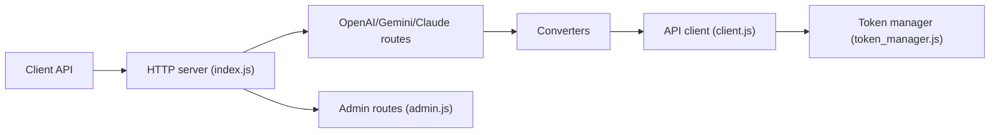

# liuw1535/antigravity2api-nodejs

> Node.js proxy that exposes the Google Antigravity API in OpenAI, Gemini or Claude format, multi-account.

## The problem
Using the models of a Google service not intended for the generic API from OpenAI, Gemini or Claude clients.

## What it actually does
Receives requests in the three formats, converts them, then calls Antigravity with OAuth account rotation, token refresh and quota tracking. Handles streaming, tools, images, structured output, reasoning. Web administration interface, SD WebUI compatibility, precompiled binaries. Port 8045.

## How it is wired


## Trying it
```bash
npm install
cp .env.example .env
cp config.json.example config.json
npm run login
npm start
```

## Cost and gotchas
Requires Google accounts and stores their tokens in plain text in data/accounts.json. Weak default credentials (admin/admin123). The README mentions a qualification workaround (random ProjectId): risk of account blocking.

## What it is not
Not an official service; it may stop working. The license is present but not identified by GitHub.

## Alternatives
No alternative named in the README.

## For you
Ignore: circumvention of a third-party service's limits with sensitive tokens, unclear license; prefer official APIs.
