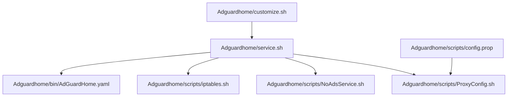

# liuzq2002/Adguard-Home-For-Magisk-Mod

> Magisk module that filters ads on rooted Android by redirecting DNS to a local AdGuard Home.

## The problem
Ads in Android apps slip past conventional blockers or slow the phone down (accessibility, VPN, hooks). Local DNS avoids those workarounds.

## What it actually does
At install time, customize.sh drops the module in place, then service.sh launches AdGuard Home with its YAML configuration. Four scripts loop every 5 seconds: iptables.sh maintains the redirection rules, NoAdsService.sh cleans ad directories and turns off private DNS, ProxyConfig.sh adapts the config of proxy modules, ModuleMOD.sh handles the language. A separate Flutter manager is offered.

## How it is wired

## Trying it
No documented command: the module is flashed from the root manager (Magisk), then you follow the README tutorial, written in Chinese.

## Cost and gotchas
Free, but the device must be rooted. The README warns: do not downgrade past version 2026.03.31, do not combine with other blockers, and the module blocks coupons and rewards in some apps.

## What it is not
Not a perfect filter: ads served from the same domain as the content (QQ, WeChat, Alipay) get through. No support if you modify or remove the module's safeguards.

## Alternatives
AdguardHome_magisk, box_for_magisk, akashaProxy and AdGuardHomeForMagisk are cited in the acknowledgements.

## For you
Ignore: rooted-Android tinkering against ads, outside your data, AI and MLOps scope.
