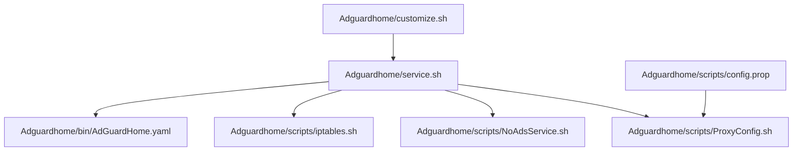

# liuzq2002/Adguard-Home-For-Magisk-Mod

> Module Magisk qui filtre les publicités sur Android root en redirigeant le DNS vers AdGuard Home local.

## Le problème
Les publicités des applications Android échappent aux bloqueurs classiques ou ralentissent le téléphone (accessibilité, VPN, hooks). Le DNS local évite ces contournements.

## Ce que ça fait vraiment
À l'installation, customize.sh dépose le module, puis service.sh lance AdGuard Home avec sa configuration YAML. Quatre scripts bouclent toutes les 5 secondes : iptables.sh maintient les règles de redirection, NoAdsService.sh nettoie les répertoires publicitaires et coupe le DNS privé, ProxyConfig.sh adapte la config des modules proxy, ModuleMOD.sh gère la langue. Un gestionnaire Flutter séparé est proposé.

## Comment c'est branché

## Essayer
Aucune commande documentée : le module se flashe depuis le gestionnaire root (Magisk) puis on suit le tutoriel du README, rédigé en chinois.

## Coût et pièges
Gratuit, mais l'appareil doit être rooté. Le README prévient : ne pas rétrograder après la version 2026.03.31, ne pas combiner avec d'autres bloqueurs, et le module bloque coupons et récompenses de certaines applications.

## Ce que ce n'est pas
Pas un filtre parfait : les publicités servies par le même domaine que le contenu (QQ, WeChat, Alipay) passent. Pas de support si l'on modifie ou retire les garde-fous du module.

## Alternatives
AdguardHome_magisk, box_for_magisk, akashaProxy, AdGuardHomeForMagisk sont cités en remerciements.

## Pour toi
À ignorer : bidouille Android root contre les publicités, hors de ton périmètre data, IA et MLOps.

