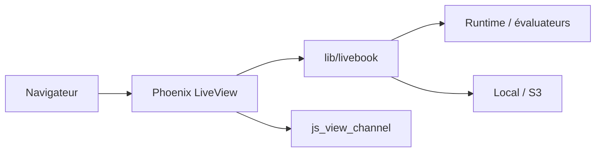

# livebook-dev/livebook

> Interactive, collaborative code notebooks for Elixir, in the browser.

## The problem
Documenting and running Elixir code reproducibly, with rich results and teamwork.

## What it actually does
Phoenix web application: Markdown and code cells, CodeMirror editor, interactive results via Kino (Vega-Lite charts, tables, maps), "Smart cells" (queries, charts), simultaneous editing. Notebooks are versionable `.livemd` files. Runtimes are standalone, attached node or existing project. Desktop, Docker, escript and Nerves firmware versions.

## How it is wired


## Trying it
```bash
docker run -p 8080:8080 -p 8081:8081 --pull always ghcr.io/livebook-dev/livebook
mix escript.install hex livebook
livebook server
```

## Cost and gotchas
Free. Anyone who can access an instance can run code on the machine: by default, local listening and a token. The package is not supported as a Mix/Hex dependency.

## What it is not
Not a Jupyter for Python: the evaluated code is Elixir.

## Alternatives
No alternative named in the README.

## For you
Worth watching: interesting if you work with the Elixir ecosystem (Nx), of no interest for a 100% Python workflow.
