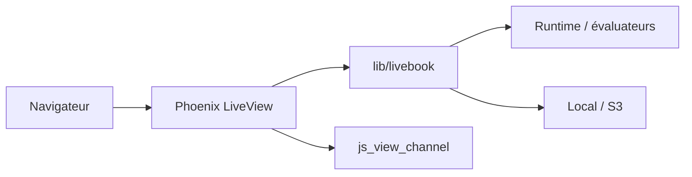

# livebook-dev/livebook

> Carnets de code interactifs et collaboratifs pour Elixir, dans le navigateur.

## Le problème
Documenter et exécuter du code Elixir de façon reproductible, avec résultats riches et travail à plusieurs.

## Ce que ça fait vraiment
Application web Phoenix : cellules Markdown et code, éditeur CodeMirror, résultats interactifs via Kino (graphiques Vega-Lite, tableaux, cartes), « Smart cells » (requêtes, graphiques), édition simultanée. Les notebooks sont des fichiers `.livemd` versionnables. Les runtimes sont autonome, nœud attaché ou projet existant. Versions desktop, Docker, escript et firmware Nerves.

## Comment c'est branché


## Essayer
```bash
docker run -p 8080:8080 -p 8081:8081 --pull always ghcr.io/livebook-dev/livebook
mix escript.install hex livebook
livebook server
```

## Coût et pièges
Gratuit. Quiconque accède à une instance peut exécuter du code sur la machine : par défaut, écoute locale et jeton. Le paquet n'est pas supporté comme dépendance Mix/Hex.

## Ce que ce n'est pas
Pas un Jupyter pour Python : le code évalué est de l'Elixir.

## Alternatives
Aucune alternative nommée dans le README.

## Pour toi
À surveiller : intéressant si tu travailles avec l'écosystème Elixir (Nx), sans intérêt pour un flux 100 % Python.

