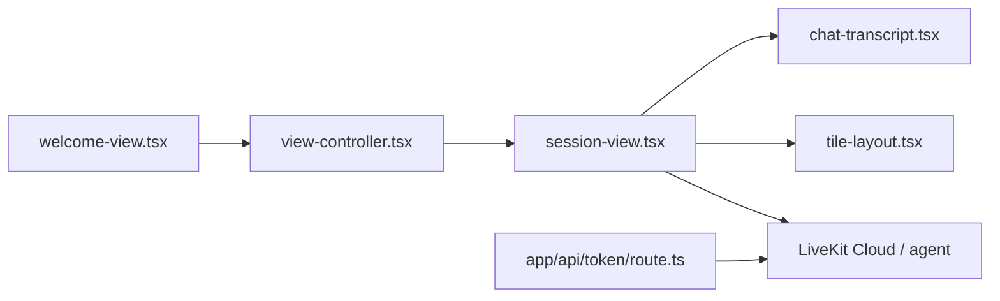

# livekit-examples/agent-starter-react

> Next.js voice interface template for LiveKit agents: voice, transcription, camera, screen sharing, avatars.

## The problem
Plugging a web voice interface into a real-time agent means setting up a session, tokens and audio components.

## What it actually does
A Next.js front end that opens a LiveKit session with your agent. It displays the transcription, media controls and audio visualizers (`bar`, `grid`, `radial`, `wave`, `aura`). It supports camera, screen sharing, a virtual avatar and themes. The components come from Agents UI via shadcn.

## How it is wired


## Trying it
```bash
git clone https://github.com/livekit-examples/agent-starter-react.git
cd agent-starter-react
pnpm install
pnpm dev
```

## Cost and gotchas
By default it talks to LiveKit's welcome agent; your own agent requires a LiveKit Cloud project and a token. The provided token server is for development only: in production, adding authentication is up to you.

## What it is not
Not an agent: it is only the interface. You need a separate LiveKit agent (Python or Node.js, or Agent Builder).

## Alternatives
- Android, Flutter, Swift and React Native versions of the same starter, cited in the README.

## For you
Adopt if you are prototyping a voice agent on LiveKit: a clean starting point under the MIT license, maintained by the vendor.
