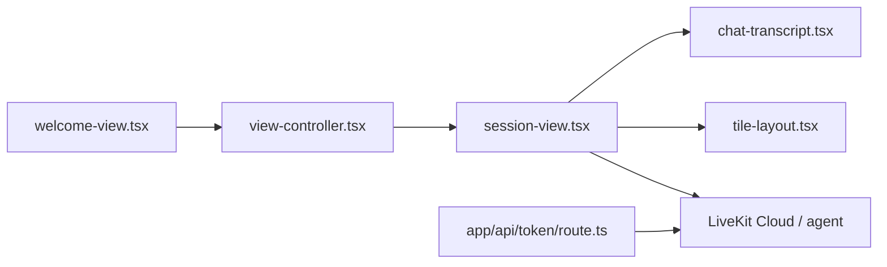

# livekit-examples/agent-starter-react

> Modèle Next.js d'interface vocale pour agents LiveKit : voix, transcription, caméra, partage d'écran, avatars.

## Le problème
Brancher une interface vocale web sur un agent temps réel demande de monter session, jetons et composants audio.

## Ce que ça fait vraiment
Un front Next.js qui ouvre une session LiveKit avec ton agent. Il affiche la transcription, les contrôles média et des visualiseurs audio (`bar`, `grid`, `radial`, `wave`, `aura`). Il supporte caméra, partage d'écran, avatar virtuel et thèmes. Les composants viennent d'Agents UI via shadcn.

## Comment c'est branché


## Essayer
```bash
git clone https://github.com/livekit-examples/agent-starter-react.git
cd agent-starter-react
pnpm install
pnpm dev
```

## Coût et pièges
Par défaut il parle à l'agent d'accueil de LiveKit ; ton propre agent demande un projet LiveKit Cloud et un jeton. Le serveur de jetons fourni est pour le développement seulement : en production, à toi d'ajouter l'authentification.

## Ce que ce n'est pas
Pas un agent : c'est seulement l'interface. Il faut un agent LiveKit à part (Python ou Node.js, ou Agent Builder).

## Alternatives
- Versions Android, Flutter, Swift et React Native du même starter, citées dans le README.

## Pour toi
Adopter si tu prototypes un agent vocal sur LiveKit : point de départ propre sous licence MIT, entretenu par l'éditeur.

