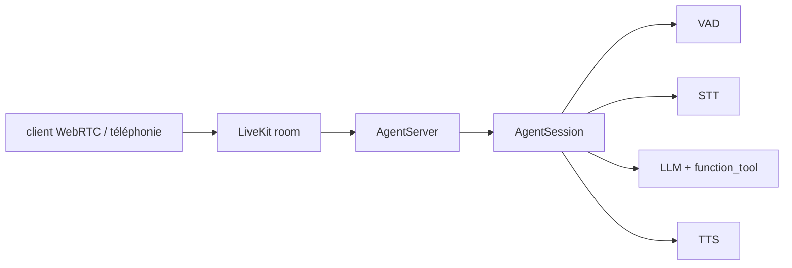

# livekit/agents

> Python framework for building real-time voice agents that run server-side.

## The problem
Putting together a voice conversation requires orchestrating VAD, transcription, LLM, synthesis and
WebRTC transport, each with its own latency and turn interruptions.

## What it actually does
The framework provides programmable real-time participants: `Agent` (instructions + tools),
`AgentSession` (container handling interactions), `entrypoint` and `AgentServer` (job
scheduling). It plugs in either separate STT/LLM/TTS or a Realtime API, detects end of turn with
a transformer model, supports MCP natively, telephony, and ships a test framework with
LLM judges (`result.expect.next_event().is_function_call(...)`).

## How it is wired


## Trying it
```bash
pip install "livekit-agents[openai,deepgram,cartesia]"
python myagent.py console
python myagent.py dev
python myagent.py start
uv run pytest --unit
```

## Cost and gotchas
The code is free, the models are not: you need `LIVEKIT_URL`, `LIVEKIT_API_KEY`,
`LIVEKIT_API_SECRET`, plus keys for Deepgram, OpenAI, Cartesia or LiveKit Cloud's hosted
inference. The plugins' integration tests require various API credentials.

## What it is not
Not a voice model: it is the orchestration around third-party models. The `console` mode
runs locally, but the `dev` and `start` modes assume a LiveKit server — Cloud or self-hosted.
Not the JS version: that one is called AgentsJS.

## Alternatives
No external alternative is named in the README; it only points to AgentsJS,
the JS/TS equivalent from the same publisher.

## For you
Worth a look if you are prototyping a voice assistant; the real cost lies in the STT/TTS providers,
not in the framework.
