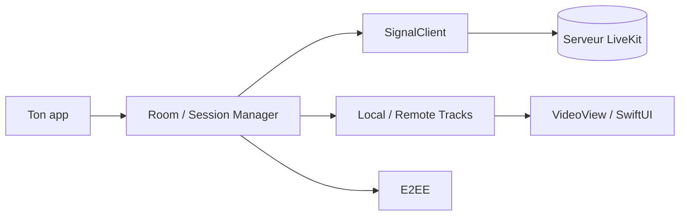

# livekit/client-sdk-swift

> Swift SDK to add real-time video, audio and data to an iOS or macOS app via LiveKit.

## The problem
Building video calls, broadcasting or voice-AI interfaces on mobile means handling WebRTC, signaling and the audio session.

## What it actually does
Provides `Room` to connect to a LiveKit server (Cloud or self-hosted), publish camera and microphone, subscribe to tracks, send data streams, encrypt end to end and share the screen. Ships with a UIKit `VideoView` and SwiftUI components. It handles the audio session and CallKit integration.

## How it is wired

## Trying it
Add the package to `Package.swift`: `.package(name: "LiveKit", url: "https://github.com/livekit/client-sdk-swift.git", .upToNextMajor("2.17.0"))`. A precompiled XCFramework distribution is offered in a separate repository.

## Cost and gotchas
A LiveKit server is required (LiveKit Cloud freemium or self-hosted). Publishing the camera is not possible on the iOS simulator. CocoaPods is deprecated.

## What it is not
It is not the voice agent framework: the README points to LiveKit Agents (Python, Node.js). This repository is the mobile client side.

## Alternatives
- LiveKit Agents: SDK for server-side voice agents.
- client-sdk-swift-xcframework: the same thing precompiled.

## For you
Ignore: mobile client SDK; only LiveKit Agents (another repository) concerns an AI profile, this one does not.
