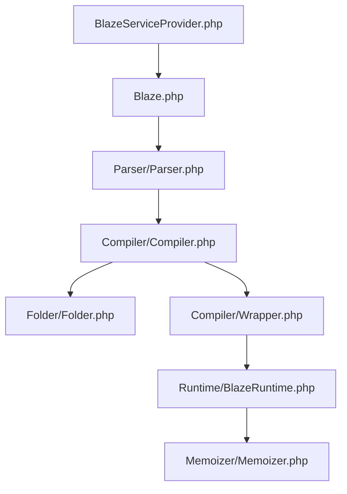

# livewire/blaze

> Speeds up the rendering of anonymous Blade components in a Laravel application.

## The problem
Rendering thousands of Blade components adds a measurable overhead to every request.

## What it actually does
Compiles templates into PHP functions instead of the standard pipeline. Two optional strategies: runtime memoization and compile-time folding (static HTML). The README quotes 25,000 components: 500 ms with Blade, 13 ms with Blaze. A debug mode with a profiler is provided.

## How it is wired


## Trying it
```bash
composer require livewire/blaze:^1.0
php artisan view:clear
```

## Cost and gotchas
No class-based components, no view composers; folding can produce subtle bugs with global state. The README figures only measure rendering overhead.

## What it is not
Not a general Laravel accelerator: only anonymous Blade components are affected.

## Alternatives
No alternative named in the README.

## For you
Specific to PHP / Laravel, unrelated to data / AI: ignore.
