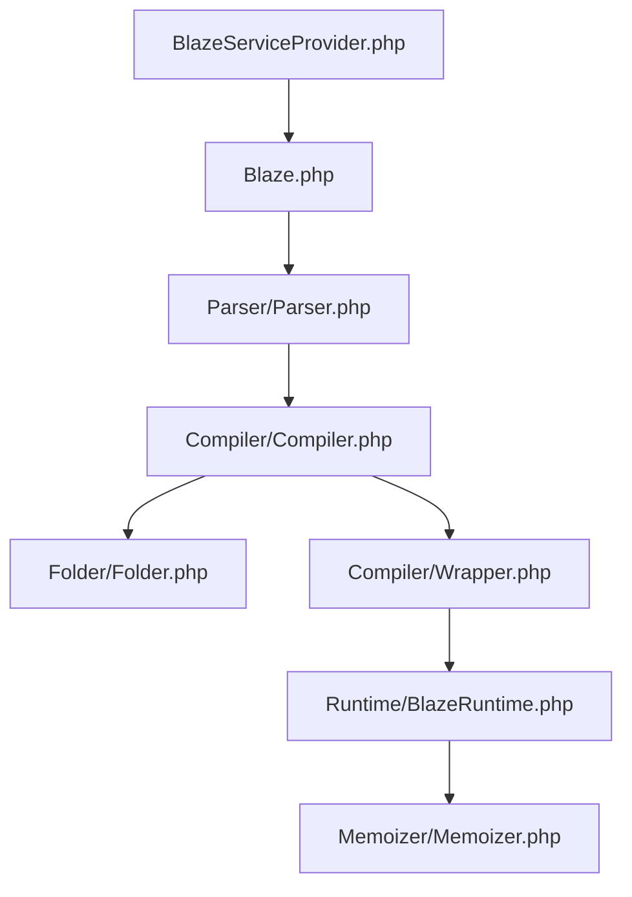

# livewire/blaze

> Accélère le rendu des composants Blade anonymes dans une application Laravel.

## Le problème
Le rendu de milliers de composants Blade ajoute un surcoût mesurable à chaque requête.

## Ce que ça fait vraiment
Compile les templates en fonctions PHP au lieu du pipeline standard. Deux stratégies optionnelles : mémoïsation à l'exécution et pliage à la compilation (HTML statique). Le README chiffre 25 000 composants : 500 ms avec Blade, 13 ms avec Blaze. Un mode debug avec profileur est fourni.

## Comment c'est branché


## Essayer
```bash
composer require livewire/blaze:^1.0
php artisan view:clear
```

## Coût et pièges
Pas de composants à classe, pas de view composers ; le pliage peut produire des bugs subtils avec l'état global. Les chiffres du README ne mesurent que le surcoût de rendu.

## Ce que ce n'est pas
Pas un accélérateur général de Laravel : seuls les composants Blade anonymes sont concernés.

## Alternatives
Aucune alternative nommée dans le README.

## Pour toi
Spécifique à PHP / Laravel, sans lien avec la data / IA : à ignorer.

