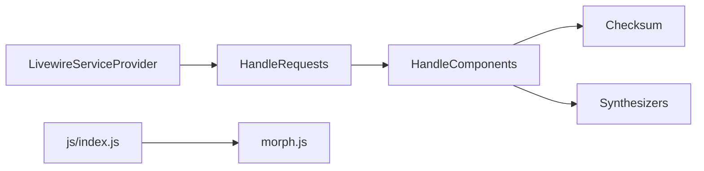

# livewire/livewire

> Full-stack framework for Laravel: dynamic interface components written in PHP.

## The problem
Building a reactive interface without leaving PHP or writing a JavaScript SPA.

## What it actually does
The README is very short. From the code: a component is a PHP class with public state and actions; the server rehydrates a snapshot, applies the changes, renders the Blade template, and returns a new signed snapshot; the browser applies the HTML by morphing. Handles uploads (including S3), navigation, validation, pagination, streaming.

## How it is wired


## Trying it
```bash
git clone git@github.com:livewire/livewire.git && cd livewire
composer setup
composer test:unit
```
(Development commands for the repository, not for use in an app.)

## Cost and gotchas
Free; requires PHP and Laravel. The README does not document installation on the user side (it points to the website).

## What it is not
Not a standalone framework: it depends on Laravel.

## Alternatives
No alternative named in the README.

## For you
Outside the data/AI profile; ignore unless you do Laravel.
