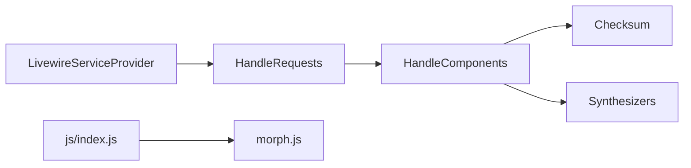

# livewire/livewire

> Framework full-stack pour Laravel : composants d'interface dynamiques écrits en PHP.

## Le problème
Construire une interface réactive sans quitter PHP ni écrire une SPA JavaScript.

## Ce que ça fait vraiment
Le README est très court. D'après le code : un composant est une classe PHP avec état public et actions ; le serveur réhydrate un instantané, applique les changements, rend le Blade, renvoie un nouveau snapshot signé ; le navigateur applique le HTML par morphing. Gère uploads (dont S3), navigation, validation, pagination, streaming.

## Comment c'est branché


## Essayer
```bash
git clone git@github.com:livewire/livewire.git && cd livewire
composer setup
composer test:unit
```
(Commandes de développement du dépôt, pas d'usage dans une appli.)

## Coût et pièges
Gratuit ; nécessite PHP et Laravel. Le README ne documente pas l'installation côté utilisateur (renvoie au site).

## Ce que ce n'est pas
Pas un framework autonome : il dépend de Laravel.

## Alternatives
Aucune alternative nommée dans le README.

## Pour toi
Hors profil data/IA ; à ignorer sauf si tu fais du Laravel.

