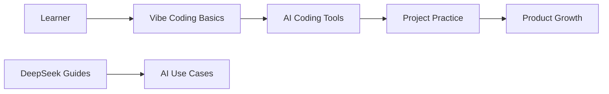

# liyupi/ai-guide

> Free Chinese-language knowledge base on AI tools and Vibe Coding, for beginners.

## The problem
Non-developers want to use AI to code and launch a product but lack reference material in Chinese.

## What it actually does
"Vibe Coding" tutorial (tools, projects, tips, monetization, resources), pages on DeepSeek (local deployment, prompts), tool tests (Cursor, Claude Code, Gemini), usage scenarios. The repository is a VuePress site; the text is in Chinese, with English and Traditional Chinese translations indicated.

## How it is wired

## Trying it
No command documented in the README: read online at https://ai.codefather.cn/vibe.

## Cost and gotchas
Free; an associated video course exists (promotion). Content under CC BY-NC-SA 4.0: commercial use prohibited without the author's written permission.

## What it is not
Not a tool or code: an editorial content site, written by one person, with a promotional tone.

## Alternatives
No alternative named in the README.

## For you
Ignore: introductory content in Chinese, aimed at beginners and monetization, of little use to a data/AI/MLOps profile.
