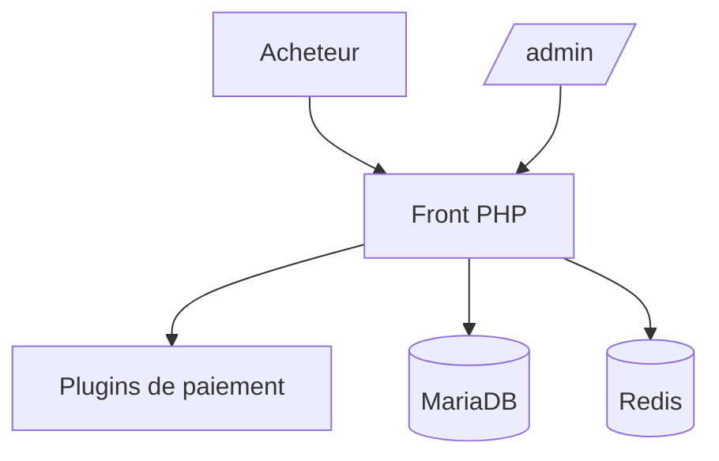

# lizhipay/acg-faka

> PHP 8 online store for automatic delivery of cards and keys, with payments as plugins.

## The problem
Selling digital keys or cards with automatic delivery, without a third-party platform.

## What it actually does
Automatic key delivery, SKUs, coupons, prices by member tier, payment gateways via plugins, sub-stores with their own domain, referral commissions, app store, more than 80 hooks, 2FA and Passkey. The README contains an advertisement for an AI token service.

## How it is wired

Diagram based on the README, no diagram provided.

## Trying it
```bash
docker run -d --name faka -p 80:80 -v acg_data:/data --restart unless-stopped ghcr.io/lizhipay/acg-faka:latest
```

## Cost and gotchas
Third-party payment gateways. The README announces MIT but forbids any commercial use: contradiction, license to verify.

## What it is not
Not usable in commerce according to its own legal warning. Documentation mostly in Chinese.

## Alternatives
No alternative named.

## For you
Ignore: e-commerce unrelated to data/AI, with an ambiguous license.
