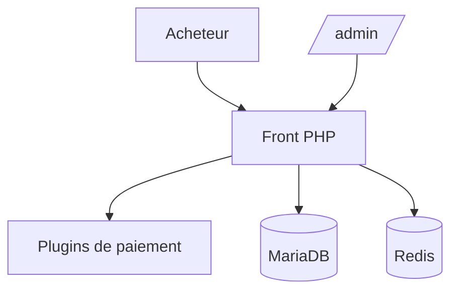

# lizhipay/acg-faka

> Boutique en ligne PHP 8 de livraison automatique de cartes et clés, avec paiements en plugins.

## Le problème
Vendre des clés ou cartes numériques avec livraison automatique, sans plateforme tierce.

## Ce que ça fait vraiment
Livraison automatique de clés, SKU, coupons, prix par niveau de membre, passerelles de paiement par plugins, sous-boutiques avec domaine propre, commissions de parrainage, boutique d'applications, plus de 80 hooks, 2FA et Passkey. Le README contient une publicité pour un service de jetons IA.

## Comment c'est branché

Schéma d'après le README, pas de diagramme fourni.

## Essayer
```bash
docker run -d --name faka -p 80:80 -v acg_data:/data --restart unless-stopped ghcr.io/lizhipay/acg-faka:latest
```

## Coût et pièges
Passerelles de paiement tierces. Le README annonce MIT mais interdit tout usage commercial : contradiction, licence à vérifier.

## Ce que ce n'est pas
Pas utilisable en commerce selon le propre avertissement légal. Documentation surtout en chinois.

## Alternatives
Aucune alternative nommée.

## Pour toi
Ignorer : e-commerce sans rapport avec data/IA, avec une licence ambiguë.

