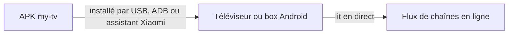

# lizongying/my-tv

> Live TV Android application for televisions and set-top boxes, installable via APK.

## The problem
Watching Chinese channels live on an Android TV without a subscription or an official app.

## What it actually does
Provides an APK to install via USB stick, Xiaomi assistant or ADB. The README lists unfinished work: favorites, volume, brightness, automatic update. It flags devices where the app crashes or does not start on its own.

## How it is wired
Simplified diagram based on the sheet, no diagram supplied.


## Trying it
```bash
adb install my-tv.apk
```

## Cost and gotchas
Free. The README asks you to delete the software within 24 hours and forbids commercial use; it warns that the project may stop at any time and incorporates resources taken from the web.

## What it is not
Not a data/AI tool. No license declared in the catalog despite a "LICENSE" mention in the README. Last push in June 2024.

## Alternatives
None named in the README (it recommends official channels).

## For you
Ignore: unrelated to data/AI/MLOps, without a clear license and with copyright risks announced by the author.
