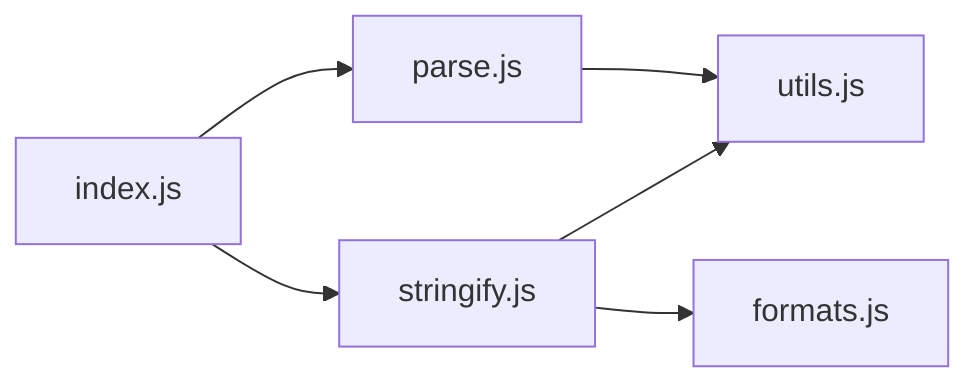

# ljharb/qs

> JavaScript library for parsing and generating query strings, with security limits.

## The problem
Nested query strings (`a[b][c]=d`) and hostile inputs (huge depth, `a[999999999]`) are poorly handled by naive parsing.

## What it actually does
`qs.parse` produces nested objects and arrays, with default limits: depth 5, 1000 parameters, arrays of 20 elements, and options to throw errors (`throwOnLimitExceeded`, `strictDepth`). `qs.stringify` supports array formats, dot notation, encoders, iso-8859-1 charset, RFC1738/3986.

## How it is wired


## Trying it
```javascript
var qs = require('qs');
var obj = qs.parse('a=c');
var str = qs.stringify(obj);
```

## Cost and gotchas
Free. Since v6.14.1 and v6.15.2, the parsing of unbalanced brackets changes. The limits do not bound the total size: also bound the HTTP body.

## What it is not
Not a complete defense against hostile inputs. Values remain strings (no conversion to numbers).

## Alternatives
- query-types: Express middleware cited by the README to convert types.
- qs-iconv: for other character sets (Shift JIS).

## For you
Worth adopting on the Node API side: BSD-3-Clause, maintained, useful limits; explicitly set `depth` and `parameterLimit` for public inputs.
