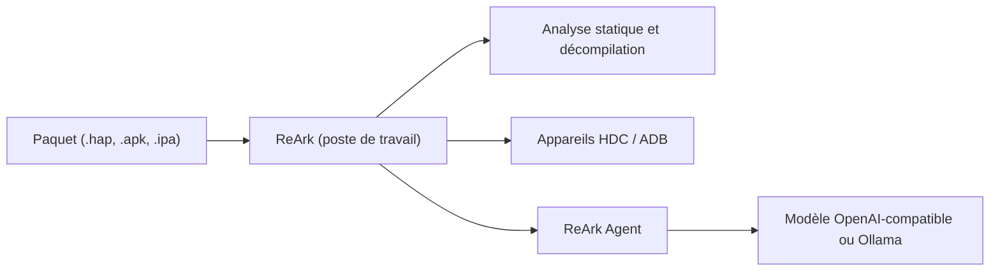

# lkimuk/ReArk

> Desktop application for analyzing HarmonyOS, Android and iOS apps, with a built-in AI agent.

## The problem
Analyzing a mobile application means juggling several decompilation, signing and on-device debugging tools.

## What it actually does
ReArk opens `.hap`, `.apk`, `.aab`, `.ipa` packages, as well as PE, ELF and Mach-O binaries, and displays code, resources, signatures and protections. It connects to devices via HDC and ADB, and version 1.2.0 adds Frida, CPU emulation, memory dump and APK modification. The agent accepts OpenAI-compatible endpoints or local Ollama.

## How it is wired
Simplified diagram based on the sheet, no diagram provided.

## Trying it
The README gives no command: you download the installer (Windows x64 or macOS Apple Silicon) from the releases page. The Linux build is announced for the next version.

## Cost and gotchas
Free on the software side; remote models are at your expense. The README asks not to send secrets, certificates or sensitive data to a remote provider. Use only for legally authorized analyses.

## What it is not
It is not a Linux tool for now, nor a library to integrate: it is a graphical application. The license is Apache-2.0 according to the catalog; the repository is young (created in May 2026).

## Alternatives
No alternative named in the README.

## For you
Worth watching: outside your core data/AI field, but the integration of an agent with an MCP server on mobile reverse engineering is worth a look if you do security.
