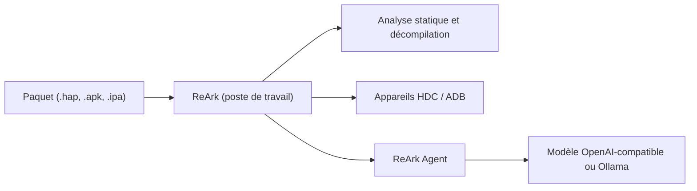

# lkimuk/ReArk

> Application de bureau pour analyser des apps HarmonyOS, Android et iOS, avec un agent IA intégré.

## Le problème
Analyser une application mobile oblige à jongler entre plusieurs outils de décompilation, de signature et de débogage sur appareil.

## Ce que ça fait vraiment
ReArk ouvre les paquets `.hap`, `.apk`, `.aab`, `.ipa`, ainsi que des binaires PE, ELF et Mach-O, et affiche code, ressources, signatures et protections. Il se connecte aux appareils via HDC et ADB, et la version 1.2.0 ajoute Frida, l'émulation CPU, le dump mémoire et la modification d'APK. L'agent accepte des points d'accès compatibles OpenAI ou Ollama local.

## Comment c'est branché
Schéma simplifié d'après la fiche, sans diagramme fourni.

## Essayer
Le README ne donne pas de commande : on télécharge l'installateur (Windows x64 ou macOS Apple Silicon) depuis la page des releases. Le build Linux est annoncé pour la prochaine version.

## Coût et pièges
Gratuit côté logiciel ; les modèles distants sont à ta charge. Le README demande de ne pas envoyer secrets, certificats ou données sensibles à un fournisseur distant. À utiliser seulement pour des analyses légalement autorisées.

## Ce que ce n'est pas
Ce n'est pas un outil Linux pour l'instant, ni une bibliothèque à intégrer : c'est une application graphique. La licence est Apache-2.0 d'après le catalogue ; le dépôt est jeune (créé en mai 2026).

## Alternatives
Aucune alternative nommée dans le README.

## Pour toi
À surveiller : hors cœur de métier data/IA, mais l'intégration d'un agent avec serveur MCP sur de la rétro-ingénierie mobile vaut un coup d'œil si tu fais de la sécurité.

