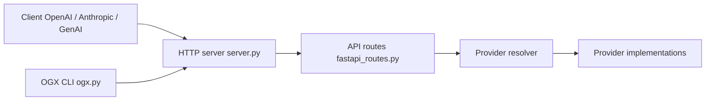

# llamastack/llama-stack

> OpenAI-compatible agentic API server (renamed OGX) for plugging in any model or infrastructure.

## The problem
Changing model or provider forces you to rewrite the client code.

## What it actually does
Exposes `/v1/chat/completions`, embeddings, the Responses API (tools, MCP, file search), vector stores, batches and skills. Also accepts the Anthropic and Google GenAI SDKs. Pluggable providers (Ollama, vLLM, managed services) are chosen through configuration.

## How it is wired


## Trying it
```bash
curl -LsSf https://github.com/ogx-ai/ogx/raw/main/scripts/install.sh | bash
uv pip install ogx
uv run ogx go
```

## Cost and gotchas
The actual models come from a provider (Ollama, vLLM or a paid service): API key or GPU at your expense. The repo has been renamed: the old and new names coexist.

## What it is not
It is not a model nor an inference runtime: it is an API layer on top of providers.

## Alternatives
No alternative named in the README.

## For you
Keep an eye on it: relevant for standardizing a MLOps team's LLM access; the renaming to OGX means checking stability before adoption.
